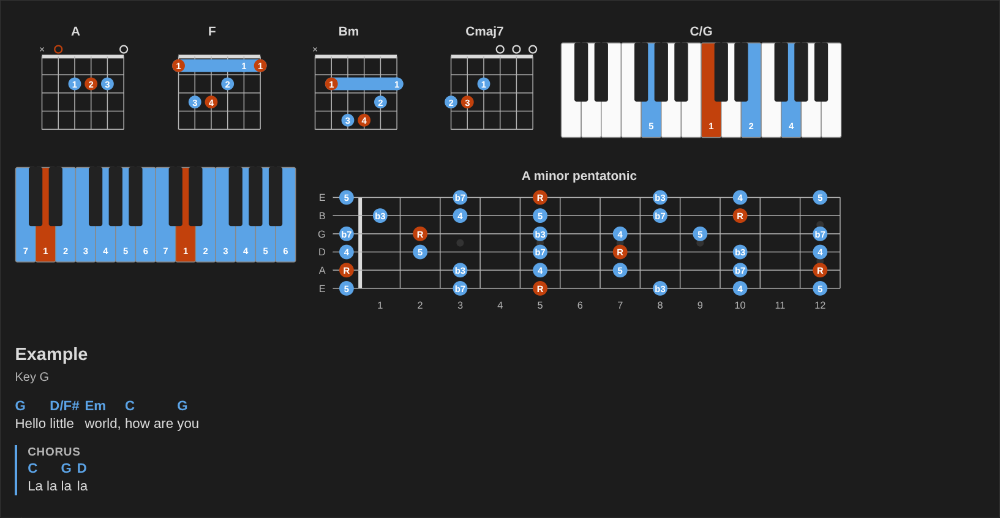
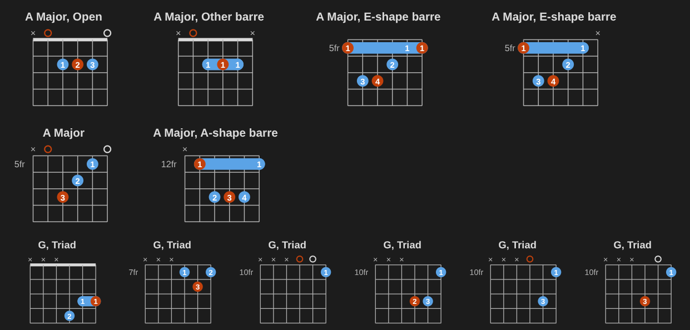
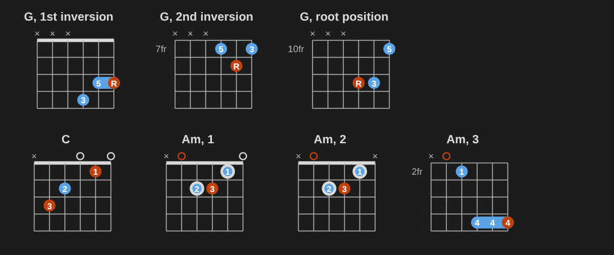
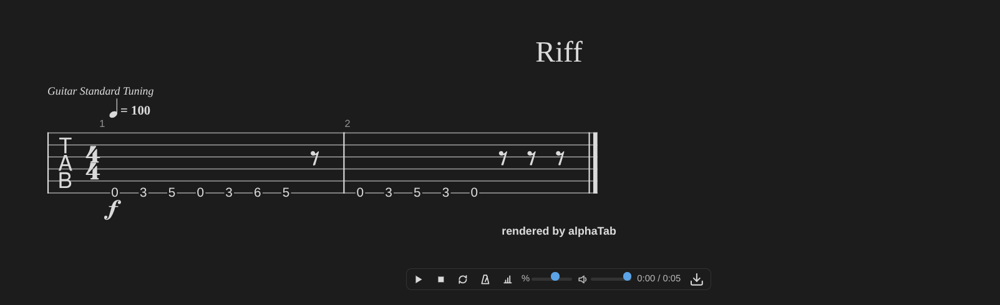

# Music Notation

Chord diagrams, piano keyboards, fretboards, ChordPro charts, strumming and fingerpicking patterns, progressions and the circle of fifths, rendered as SVG and HTML from small text blocks. No framework, no build step for pages that load the browser bundle. Made for [Obsidian](https://obsidian.md) (the [Music Practice](https://github.com/dsebastien/obsidian-music-practice) plugin and Obsidian Publish), usable on any web page.



## Blocks

Each block is a fenced code block whose language says what it draws:

````markdown
```chord
A x02220 x01230
```

```chord
C/G
instrument: piano
hands: left+right
fingering: 5 1 3 5
```

```keyboard
D dorian
labels: degrees
```

```fretboard
scale: A minor pentatonic
frets: 5-8
labels: intervals
```

```chords
{title: Example}
{key: G}
[G]Hello [D/F#]little [Em]world
```
````

Chords in words or recognized from their frets, every way to play a chord, triads, chord transitions, scale positions and modes:

````markdown
```chord
F Sharp Minor 7
---
frets: x02220
```

```chord
A Major
voicings: 6
```

```chord
G
triads: 1-3
```

```chord
from: C x32010
to: Am
```

```fretboard
A minor pentatonic
positions: all
```

```keyboard
modes: C major
```
````

Progressions in roman numerals or Nashville numbers, the circle of fifths, and the scale that fits a song's chords:

````markdown
```progression
I V vi IV
key: G
```

```circle
key: E minor
```

```fretboard
scales-for: G D Em C
```
````

Strumming patterns written the way you find them on the web, a capo, arpeggios, scale and arpeggio runs as tab exercises, piano voicings, and chord diagrams above a chart:

````markdown
```strum
[G]D - D U [C]- U D U
```

```chord
A x02220 x01230
capo: 2
sounds: yes
```

```fretboard
arpeggio: Am7
positions: all
```

```chord
Dm7
instrument: piano
voicing: rootless A
```

```chords
{capo: 2}
{diagrams: on}
[G]Hello [Cadd9]little [Em]world
```
````







Several diagrams side by side, separated by `---`, with shared settings first; vertical or horizontal, and left-handed:

````markdown
```chord
orientation: horizontal
hand: left
---
G 320003 210003
---
C x32010 x32010
```
````

The full syntax is in the [guide](https://dsebastien.github.io/music-notation/), with [live examples](https://dsebastien.github.io/music-notation/examples.html) and a [playground](https://dsebastien.github.io/music-notation/playground.html). Mistakes show an inline message and leave the source untouched.

## Install

```bash
npm install @dsebastien/music-notation
```

```ts
import { renderBlock, injectStyles } from '@dsebastien/music-notation'
import { lookupGuitarVoicing } from '@dsebastien/music-notation/voicings'

injectStyles(document)
const result = renderBlock('chord', 'Am', container, { voicings: lookupGuitarVoicing })
if (!result.ok) console.warn(result.error)
```

- `renderBlock(language, source, host, options)` appends the rendering to `host` and never throws. It returns `{ ok, el, error, destroy() }`.
- `@dsebastien/music-notation/voicings` adds about 1,800 guitar voicings, found by chord symbol (`chord` blocks with only a symbol). It's a separate entry point because the data weighs about 230 KB.
- **Hear the diagrams**: with the `play` option, a click on a diagram plays it and a click on a dot or a key plays that note; one bar under each block plays the selected diagram or all of them in turn, with loop, speed and the sound (the volume is the app's setting). Guitar chords strum, piano chords strike as a block, scales run from their tonic up and back. While it plays, each note lights up on the drawing when you hear it.
- **Strumming patterns**: `strum` blocks draw a pattern (`D DU UDU`, `D - D U - U D U`) on a beat grid with counts, accents, muted and ghost strums and chord changes; with playback on, they play over their chords, with loop, tempo and a count-in. `playStrum(pattern, { bpm, chord, tuning })` plays one from code.
- **Practice in time**: `progression` blocks and ChordPro charts get a bar that plays their chords in time, one chord a bar (or as a chart's bar lines say), with a metronome click, a count-in and a loop. Each chord is strummed on the beats, once a bar, as an arpeggio or to a strumming pattern, and the chord playing lights up. `playProgression(chords, { bpm, strum, pattern, click, countIn, loop })` does it from code, with your own player.
- **Harmonize a scale**: a `progression` block with `harmonize: triads`, `sevenths`, `sus` or `power` and any 7-note scale as its `key:` (`A harmonic minor`, `D dorian`) draws the chord on each degree with its numeral and a diagram, ready to play in time. `harmonize(scale, { kind })` gives the same chords from code.
- **Fingerpicking patterns**: `picking` blocks draw a pattern in PIMA letters (p, p' for the alternate bass, i, m, a) or string numbers as a small tab, over a chord or a progression, and play it in time. Travis, alternate bass and 1-2-3-4 come by name. `playPicking(pattern, { chord, chords, bpm })` plays one from code.
- **Tabs and scores**: `@dsebastien/music-notation/tab` draws `tab` and `score` blocks (alphaTex, or Guitar Pro and MusicXML files) with [alphaTab](https://alphatab.net), and adds a player. It also converts score files, text tabs and chord sheets, and exports Guitar Pro 7 and MIDI.
- `generateVoicings(symbol, options)` finds every playable voicing of a chord on any tuning, easiest first, with fingers and shape names; `fingerVoicing(frets)` fingers any voicing. `fingeringInWords(chord)` writes a guitar or piano chord's fingering in plain sentences, as `caption: fingering` shows it under a diagram.
- The renderers (`renderGuitarDiagram`, `renderKeyboard`, `renderFretboard`, `renderChart`, `renderStrum`, `renderPicking`, `renderCircle`), the parsers and the theory helpers (`parseChord`, `transposeChord`, `chordNoteSet`, `scaleNoteSet`…) are exported too.
- Note names in solfège (Do Ré Mi) or German (H for B): `naming: solfege` or `naming: german` in a block, or as an option; notes may be written in any of the three systems.
- A pick layer for drills: with `pick`, every string × fret of a fretboard and every key of a keyboard is a target that a click or the keyboard picks; the app marks picks right or wrong (`attachPick`).
- Styles: `injectStyles(document)`, or ship `@dsebastien/music-notation/music-notation.css`. Colors follow Obsidian's theme variables, with fallbacks for any page.

## Check your notes

The `check` command draws every block of your Markdown files and lists the mistakes, one per line (`file:line: language: message`). It exits with code 1 when a block has a mistake:

```bash
npx @dsebastien/music-notation check notes/*.md
```

`--describe` prints what each block draws (titles, chord names, the notes of each dot or key, the frets or keys shown), and `--json` prints the same as JSON. The [guide](https://dsebastien.github.io/music-notation/check.html) has the details.

## Obsidian Publish

Add this to your site's `publish.js`. It loads the bundle only on pages that have notation blocks, and the tab bundle (with alphaTab) only on pages with tabs or scores:

```js
;(() => {
    const VERSION = '0.18.0'
    const CDN = `https://cdn.jsdelivr.net/npm/@dsebastien/music-notation@${VERSION}/dist`
    const selector = (languages) => languages.map((l) => `pre > code.language-${l}`).join(', ')
    const BLOCKS = selector([
        'chord',
        'chords',
        'keyboard',
        'fretboard',
        'strum',
        'picking',
        'progression',
        'circle'
    ])
    const TABS = selector(['tab', 'score'])
    const requested = new Set()
    const load = (file) => {
        if (requested.has(file)) return
        requested.add(file)
        const script = document.createElement('script')
        script.src = `${CDN}/${file}`
        document.head.appendChild(script)
    }
    const check = () => {
        if (document.querySelector(BLOCKS)) load('music-notation.publish.min.js')
        if (document.querySelector(TABS)) load('music-notation.tab.min.js')
    }
    check()
    new MutationObserver(check).observe(document.body, { childList: true, subtree: true })
})()
```

The bundle renders every block, now and as you navigate, and hides a block's source only once it rendered.

## Credits and licenses

MIT. Built on [tonal](https://github.com/tonaljs/tonal) (MIT) for music theory and [chords-db](https://github.com/tombatossals/chords-db) (MIT) for guitar voicings. The `check` command bundles [linkedom](https://github.com/WebReflection/linkedom) (ISC) for the DOM in Node. Tabs and scores use [alphaTab](https://alphatab.net) (MPL-2.0), which the app passes in. The tab bundle loads it from jsDelivr.

## News & support

To stay up to date about this library, Obsidian in general, personal knowledge management and note-taking:

- Subscribe to [my newsletter](https://dsebastien.net/newsletter)
- Subscribe to [my YouTube channel](https://youtube.com/@dsebastien)
- Join the [Knowii community](https://www.store.dsebastien.net/product/knowii-community/)

If this is useful to you:

- [Become a GitHub Sponsor](https://github.com/sponsors/dsebastien)
- [Buy me a coffee](https://www.buymeacoffee.com/dsebastien)
- [Check out my products](https://store.dsebastien.net)
