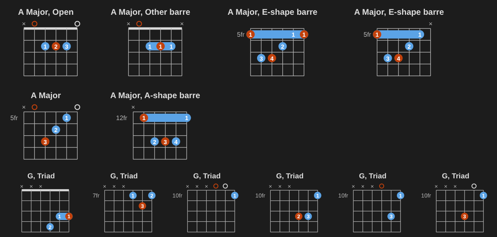
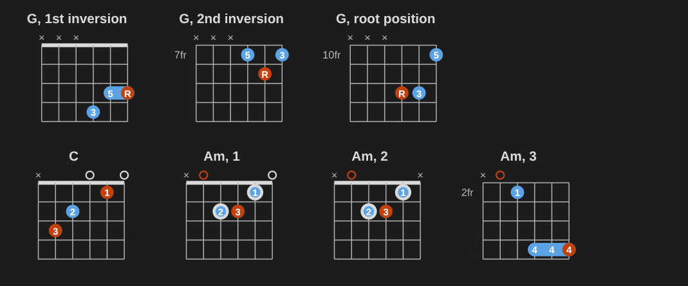
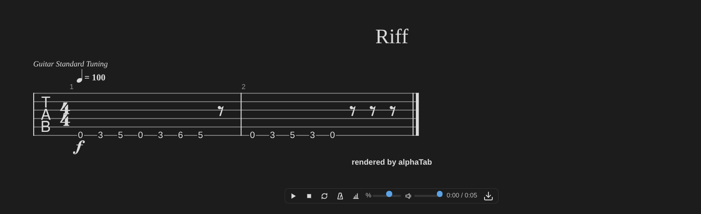

# Blocks

A block is a fenced code block. Its language picks what's drawn: `chord`, `keyboard`, `fretboard`, `chords`, `strum` ([strumming patterns](#strumming-patterns)), `progression` ([progressions](#progressions)), `circle` ([circle of fifths](#circle-of-fifths)), or `tab` and `score` ([tabs and scores](#tabs-and-scores)). Inside, one `key: value` per line; most blocks also accept a short first line without a key. `chord`, `keyboard` and `fretboard` blocks can hold [several diagrams](#several-diagrams), drawn [vertically or horizontally](#orientation-and-left-handed-diagrams).

## Chord

A guitar diagram, or a piano chord.

````markdown
```chord
A x02220 x01230
```
````

<div class="mn-live" markdown="0"><pre><code class="language-chord">A x02220 x01230</code></pre></div>

The short form is `chord frets fingers`, the chord as a symbol or in words (`A Major x02220 x01230`). The same chord with keys:

````markdown
```chord
symbol: A
frets: x02220
fingers: x01230
title: A (open)
```
````

<div class="mn-live" markdown="0"><pre><code class="language-chord">symbol: A
frets: x02220
fingers: x01230
title: A (open)</code></pre></div>

| Key                 | Meaning                                                                                                                                                                                                                                                                                                                                                            |
| ------------------- | ------------------------------------------------------------------------------------------------------------------------------------------------------------------------------------------------------------------------------------------------------------------------------------------------------------------------------------------------------------------ |
| `symbol`            | Chord symbol (`A`, `F#m7`, `B♭`, `C/G`, `C6/9`) or name in words (`A Major`, `F Sharp Minor 7`, `C Major over G`). Spellings from chord sheets on the web work too: `C7(b9)`, `Cm(add9)`, `Cmaj7b5`, `C-5`. Its root notes are highlighted. Also the title, unless `title` is set. A symbol the library doesn't know still works with `frets`, without root marks. |
| `frets`             | One per string, lowest string first. `x` = muted, `0` = open. Above fret 9, separate them: `x-10-12-12-11-10`.                                                                                                                                                                                                                                                     |
| `fingers`           | One per string: `1`–`4`, `T` (thumb); `0` or `x` = none. The same finger on the same fret draws a barre, with its finger number once.                                                                                                                                                                                                                              |
| `voicing`           | With only a symbol, the n-th voicing from the built-in database (1 = the most common: the shape a teacher would show first, with the root in the bass). A chord the database doesn't have gets the 4 easiest voicings the library finds from its notes, as in [all the ways to play a chord](#all-the-ways-to-play-a-chord).                                       |
| `position`          | The first fret shown; at most the lowest fretted note. Computed when absent.                                                                                                                                                                                                                                                                                       |
| `tuning`            | For other tunings or instruments: `Drop D`, `DADGAD`, `E2 A2 D3 G3`, `ukulele`…                                                                                                                                                                                                                                                                                    |
| `instrument`        | `piano` draws a keyboard.                                                                                                                                                                                                                                                                                                                                          |
| `pitches`           | Piano: `A3 C#4 E4`, or `A C# E` (stacked upwards from middle C).                                                                                                                                                                                                                                                                                                   |
| `fingering`         | Piano: one finger per key, low to high: `5-3-1`. Shown on the keys (`labels: notes` shows note names instead).                                                                                                                                                                                                                                                     |
| `title`             | The title shown above.                                                                                                                                                                                                                                                                                                                                             |
| `name`              | Also the title; when it reads as a chord (`name: A`, `name: A Major`), its root notes are highlighted too.                                                                                                                                                                                                                                                         |
| `orientation`       | `vertical` (default for guitar) or `horizontal`; piano chords are `horizontal` by default. See [orientation](#orientation-and-left-handed-diagrams).                                                                                                                                                                                                               |
| `hand`              | `left` mirrors the diagram for left-handed players.                                                                                                                                                                                                                                                                                                                |
| `labels`            | Guitar: what the dots say, `fingers` (default), `intervals` (R, 3, 5, as triad charts show them), `notes` (G, not F##) or `none`. With `intervals` or `notes`, a full barre (F `133211`) keeps its bar with each label on it; a small one (two strings of a triad) is drawn only when its dots say the same thing.                                                 |
| `anchors`, `guides` | Guitar: strings (1 = the highest) whose finger stays on its fret (a ring) or slides along the string (a dashed ring), as [chord transitions](#chord-transitions) mark them.                                                                                                                                                                                        |
| `capo`              | Guitar: a capo on that fret; frets count from it. See [capo](#capo).                                                                                                                                                                                                                                                                                               |
| `frets-from`        | `nut`: the frets you write count from the nut. See [capo](#capo).                                                                                                                                                                                                                                                                                                  |
| `sounds`            | `yes`, or the chord: the chord the shape sounds with the capo, in the caption.                                                                                                                                                                                                                                                                                     |

Roots and basses can have double sharps and flats: `F##dim` (or `Fxdim`), `Ebb`.

Without a symbol or name, the chord is recognized from its `frets` (in the block's tuning) or `pitches`, and titled with what it found: `frets: x02220` draws an A diagram. Common chords come first, so `E4 G4 C5` reads as C/E. Shell voicings (root, 3rd and 7th, without the 5th) are named as if the 5th were there: `3x44xx` is Gmaj7. 13th grips that leave out the 5th, 9th and 11th are still 13th chords, so `020120` is E13. And a slash chord's bass is spelled the way the chord spells it: `x12010` is C7/Bb, not C7/A#. Five notes or more that only move by steps (half or whole steps) within an octave are a hand position, not a chord: `pitches: C4 D4 E4 F4 G4` gets no name and no root marks (it isn't Dm11/C). Chords with a step in them still get their names, such as Cadd9 (C D E G), Csus2 (C D G) and four-note jazz clusters like Cmaj9/B (B C D E). Keys written with flats or sharps name the chord the same way: `pitches: Db3 F4 B4 Eb5` is Db9 (C#9 when written C#), and `G3 B3 F4 Ab4 Eb5` is G7b9b13. With a symbol, the keys are spelled by the symbol: `symbol: Cdim7` over `pitches: C4 Eb4 Gb4 A4` labels the A as Bbb, as `Cdim7` alone does. A chord the library doesn't recognize says what to write instead.

A piano chord from its symbol is voiced in root position from middle C; a slash chord's bass goes an octave below. [Piano voicings](#piano-voicings) change that.

````markdown
```chord
C/G
instrument: piano
hands: left+right
fingering: 5 1 3 5
```
````

<div class="mn-live" markdown="0"><pre><code class="language-chord">C/G
instrument: piano
hands: left+right
fingering: 5 1 3 5</code></pre></div>

## Piano voicings

A piano chord from a symbol can be inverted, moved, voiced and split between the hands:

````markdown
```chord
C
instrument: piano
inversion: second
hands: left+right
fingering: auto
```
````

<div class="mn-live" markdown="0"><pre><code class="language-chord">C
instrument: piano
inversion: second
hands: left+right
fingering: auto</code></pre></div>

| Key         | Meaning                                                                                                                                                                                                                                                                                                                                                                                                                                                                                                                                                                                                                                                                                                  |
| ----------- | -------------------------------------------------------------------------------------------------------------------------------------------------------------------------------------------------------------------------------------------------------------------------------------------------------------------------------------------------------------------------------------------------------------------------------------------------------------------------------------------------------------------------------------------------------------------------------------------------------------------------------------------------------------------------------------------------------- |
| `inversion` | The chord's note in the bass: `root` (or `0`), `first` (`1`, the third), `second` (`2`, the fifth), `third` (`3`, the seventh). C first inversion is E4 G4 C5, titled C/E. A slash chord already has its bass.                                                                                                                                                                                                                                                                                                                                                                                                                                                                                           |
| `octave`    | The octave of the lowest right-hand note: `4` (middle C's) by default, `3` one octave lower. Rootless voicings start in octave `3`.                                                                                                                                                                                                                                                                                                                                                                                                                                                                                                                                                                      |
| `voicing`   | `close` (default: the notes stacked as close as they go), `open` (the note above the bass goes up an octave: C G E), `shell` (root, third, seventh: Cmaj7 is C E B), `shell R-7` (root, seventh, third: C B E), `rootless A` or `rootless B` (jazz).                                                                                                                                                                                                                                                                                                                                                                                                                                                     |
| `hands`     | `left+right`: the bass (the root, an inversion's note, or a slash chord's bass) in the left hand, an octave below the right hand. `left`: the whole chord in the left hand (octave 3 by default). An L or R under each key says which hand plays it.                                                                                                                                                                                                                                                                                                                                                                                                                                                     |
| `fingering` | `auto`: the usual fingers for a three-note chord in close position (right hand 1 3 5, first inversion 1 2 5; left hand 5 3 1, second inversion 5 2 1). With both hands the bass gets 5; when it is the third, the right hand keeps two notes: 1 5 a fifth apart, 1 4 a fourth (D/F#: 5, then 1 5). Seventh and sixth chords get fingers by their spacing: four notes 1 2 3 5, or 1 2 4 5 with a second on top (C7 first inversion E G Bb C); three notes 1 3 5 (C7/E with both hands: E, then C G Bb), or 1 3 4 when they fit in a fourth (C7 first inversion with both hands: E, then G Bb C). The left hand alone plays 5 3 2 1, or 5 4 2 1 with a second at the bottom. Otherwise, write the fingers. |

An inverted chord is titled with its slash name: C first inversion is C/E, second inversion C/G. A `title` replaces it.

Rootless voicings leave out the root, which a bass player or the left hand plays. Form A is 3 5 7 9, form B is 7 9 3 5. Dominant chords use the 13th instead of the 5th, and keep an altered 9th or 5th when the symbol has one. Half-diminished chords keep their b5 and take the natural 9th: Dm7b5 A is F Ab C E (b3 b5 b7 9), B is C E F Ab. A ii-V-I in C: Dm7 (A) F3 A3 C4 E4, G7 (B) F3 A3 B3 E4, Cmaj7 (A) E3 G3 B3 D4. The lowest note is in octave 3, so the chord stays between C3 and C5, where pianists comp. They work for major, minor, dominant and half-diminished seventh chords and sixth chords. Dominant sus chords put the 4th in place of the 3rd and keep the 5th (the 13th when the symbol has one): G7sus4 A is C D F A, B is F A C D. A shell takes the sus note for the third: G7sus4 is G C F. `labels: intervals` shows the added 9th and 13th.

Shell voicings come in two forms: R-3 (`shell`, the third right above the root: C E B) and R-7 (`shell R-7`, the seventh right above the root, the third on top: C B E).

The right hand doesn't double the bass when it is the third or the seventh: D/F# is F#3 + D4 A4, not F#3 + D4 F#4 A4. With `hands: left+right`, shell, open and rootless voicings leave the root to the left hand: a Cmaj7 shell is C3 + E4 B4. A close voicing keeps a root or fifth in the bass doubled (C is C3 + C4 E4 G4), as pianists play a left-hand root under a right-hand triad.

`inversion` means something else in [all the ways to play a chord](#all-the-ways-to-play-a-chord): there it picks guitar voicings with that note in the bass. `hand: left` (singular) mirrors guitar diagrams; `hands` is for piano chords. These keys need a chord symbol: `pitches` already says which keys to play.

## Capo

`capo: 2` puts a capo on fret 2 of a `chord` or `fretboard` block. It is drawn as a bar across the strings, and a caption under the diagram says "Capo 2".

````markdown
```chord
A x02220 x01230
capo: 2
sounds: yes
```
````

<div class="mn-live" markdown="0"><pre><code class="language-chord">A x02220 x01230
capo: 2
sounds: yes</code></pre></div>

- Frets count from the capo, the way players read them: an A shape is still `x02220`. The capo is drawn where the nut is, and an open string sounds at the capo.
- The chord is the shape you play (`A`). It sounds higher: an A shape with a capo on 2 sounds B. Root marks, `labels: notes` and playback use the notes that sound.
- `sounds: yes` adds the chord that sounds to the caption ("Capo 2, sounds B"). You can write the chord instead (`sounds: B`); if it isn't the chord the shape sounds, the block tells you which one it is.
- `frets-from: nut` counts the frets you write from the nut: `frets: x24442` with `capo: 2` is the same A shape. The diagram then shows the real neck: the capo sits on its fret, and the strings it plays are rings on it. Every sounding fret must be at the capo or above.
- On a fretboard, `frets:` and positions count from the capo too, and the strings are named by what they sound. Positions are found from the capo, as if it were the nut. With `frets-from: nut`, the fretboard shows the real neck and nothing behind the capo.
- `capo`, `frets-from` and `sounds` can be shared by a row. `voicings:`, `triads:` and transitions draw the shapes as played from the capo.
- A capo goes from fret 1 to 12; `capo: 0` is no capo. Piano chords don't take one.

````markdown
```fretboard
A minor pentatonic
position: 1
capo: 2
labels: intervals
```
````

<div class="mn-live" markdown="0"><pre><code class="language-fretboard">A minor pentatonic
position: 1
capo: 2
labels: intervals</code></pre></div>

## All the ways to play a chord

`voicings:` draws every playable way to play a guitar chord, easiest first, in a row. The library finds them from the chord's notes, so it works for any chord, any tuning and up to 8 strings.



````markdown
```chord
A Major
voicings: 6
```
````

<div class="mn-live" markdown="0"><pre><code class="language-chord">A Major
voicings: 6</code></pre></div>

Narrow them down: C between frets 3 and 9, without open strings, four columns:

````markdown
```chord
C
voicings: all
area: 3-9
open: no
columns: 4
```
````

<div class="mn-live" markdown="0"><pre><code class="language-chord">C
voicings: all
area: 3-9
open: no
columns: 4</code></pre></div>

| Key           | Meaning                                                                                                                         |
| ------------- | ------------------------------------------------------------------------------------------------------------------------------- |
| `voicings`    | `all` (at most 32), or how many: the easiest first.                                                                             |
| `area`        | The frets the fretted notes stay within: `5-9` (`0-3` starts at the nut), or `open` (frets 1–4).                                |
| `root-string` | The string the bass note is on, counted the way guitarists do: 1 is the highest string, 6 the lowest. `6` gives E-shape chords. |
| `strings`     | The strings that may sound: `1-3` (the three highest), `2-4`, or a list (`1 2 3`; strings apart, like `1 2 4`, need `gaps`).    |
| `inversion`   | The chord's note in the bass: `0` (root, the default), `1`, `2`, `3` (usually the third, fifth, seventh), or `any`.             |
| `stretch`     | `yes`: the hand may cover five frets instead of four.                                                                           |
| `open`        | `no`: no open strings.                                                                                                          |
| `gaps`        | `yes`: muted strings may sit between sounding ones (jazz shells).                                                               |

`tuning`, `orientation`, `hand`, `labels`, `columns` and `title` work as in any row (`title` replaces the chord in each diagram's title). `frets`, `fingers`, `voicing`, `position` and piano keys can't be used with `voicings:`.

On a re-entrant tuning (a ukulele's high G string), any chord note may be lowest unless `inversion` says otherwise, so the usual shapes (F `2010`, G `0232`) come first. On 7 or 8 strings, use one of `gaps`, `stretch` and a wide `area` at a time, and `inversion: any` with six `strings` or fewer: there are many more combinations to go through.

Each voicing must sound the root, the third (or the sus note), the seventh or sixth, altered notes and the highest extension; the perfect fifth and lower extensions may be left out. A slash chord keeps its bass lowest. No pitch sounds on two strings at once (except on a ukulele's re-entrant tuning). Fingers are worked out: any finger can hold a note, the index or the ring finger can barre a few strings on one fret (the pinky never, in generated voicings), only the index can lie across strings fretted higher (a full barre), the finger numbers go up with the frets, and at most four fingers in all; the easiest way wins (a small index barre over the top strings, like F `xx3211`, counts as easy). Muted strings between sounding ones are left out unless `gaps: yes`.

Easiest first means: the open chords guitarists learn first (C, A, G, E, D, Am, Em, Dm, their sevenths, sus and add9 shapes), then fewer fingers, a smaller span, no full barre, reach or awkward fingering, the usual shapes (E- and A-shape barres, the CAGED shapes), all strings sounding (a muted high string costs more than a muted low one), no open string ringing inside a shape up the neck, lower on the neck. Each diagram is titled with the chord and its shape when it has a usual one: Open, C shape, A shape, G shape, E shape, D shape (with a barre or not), Power chord, Triad or Shell.

`voicing: 3` (singular) still picks the third voicing of the built-in database (see [Examples](examples.html)).

## Triads on string sets



Triads on three strings next to each other, in their three inversions, are how guitarists learn the neck. `triads:` draws a chord's triads on a string set, up the neck, with R, 3 and 5 in the dots:

````markdown
```chord
G
triads: 1-3
```
````

<div class="mn-live" markdown="0"><pre><code class="language-chord">G
triads: 1-3</code></pre></div>

`inversion: 0` (root position), `1` or `2` keeps only one inversion. With `key:`, the block draws the key's seven triads in one inversion, moving up the neck, titled with their numerals:

````markdown
```chord
key: C major
triads: 2-4
inversion: 1
```
````

<div class="mn-live" markdown="0"><pre><code class="language-chord">key: C major
triads: 2-4
inversion: 1</code></pre></div>

| Key         | Meaning                                                                                      |
| ----------- | -------------------------------------------------------------------------------------------- |
| `triads`    | The string set: `1-3`, `2-4`, `3-5` or `4-6` (1 = the highest string).                       |
| `inversion` | `0` (root position), `1` or `2`. All of them by default; with a key, only the root position. |
| `key`       | `G major`, `E minor`: the key's seven triads instead of one chord's.                         |
| `labels`    | `intervals` by default here, or `fingers` or `notes`.                                        |

Triads need a three-note chord (major, minor, diminished, augmented, sus). The shapes stay within four frets. On a fretboard, `strings: 1-3` shows a chord's notes on those strings only.

## Chord transitions

Changing chords cleanly is mostly about which voicing you pick and which fingers can stay down. `from:` and `to:` draw the chord you hold, then the next chord's voicings the hand reaches most easily. Fingers that stay on their fret have a ring. Fingers that slide along their string (3 frets at most; past that, you lift the finger) have a dashed ring.

````markdown
```chord
from: C x32010
to: Am
```
````

<div class="mn-live" markdown="0"><pre><code class="language-chord">from: C x32010
to: Am</code></pre></div>

`count: 5` shows more voicings. Without frets (`from: C`), the block starts from the chord's easiest voicing. For a whole progression, `progression:` picks the voicings that make it easiest overall, the shapes and the moves together. It prefers the standard shapes a teacher would write: open chords and barre chords near the nut, with the root in the bass:

````markdown
```chord
progression: G D Em C
columns: 4
```
````

<div class="mn-live" markdown="0"><pre><code class="language-chord">progression: G D Em C
columns: 4</code></pre></div>

Separate the chords with spaces, or with commas or bars when they're written in words (`progression: C, A Minor, F`). The library also says what to do in plain words (`transition` in the [API](api.html)): "Keep your middle finger on the D string's 2nd fret", "Slide your ring finger along the B string from fret 2 to 3".

## Keyboard

A piano keyboard with the notes of a scale, a chord or a list.

````markdown
```keyboard
D dorian
labels: degrees
```
````

<div class="mn-live" markdown="0"><pre><code class="language-keyboard">D dorian
labels: degrees</code></pre></div>

| Key                    | Meaning                                                                                                                                                                                                                                                                                                                                         |
| ---------------------- | ----------------------------------------------------------------------------------------------------------------------------------------------------------------------------------------------------------------------------------------------------------------------------------------------------------------------------------------------- |
| `scale`                | `C major`, `A minor pentatonic`, `D dorian`, `E harmonic minor`…                                                                                                                                                                                                                                                                                |
| `chord`                | `Cmaj7`, `G7`, `F#m7b5`…                                                                                                                                                                                                                                                                                                                        |
| `notes`                | `C E G` (every octave), or `C4 E4 G4` (those keys only).                                                                                                                                                                                                                                                                                        |
| `root`                 | For `notes`: the note that `intervals` and `degrees` labels count from, `root: C`. It doesn't have to be in the list.                                                                                                                                                                                                                           |
| `range`                | Keys shown: `C3-B4`. By default, a scale shows two octaves from its tonic to the tonic (see below); chords and notes without octaves show two octaves from middle C; exact notes show the whole octaves around them.                                                                                                                            |
| `labels`               | `notes` (default), `degrees` (a chord's 1 3 5 7, a scale's 1–7), `intervals` (R, b3, 5…), `none`.                                                                                                                                                                                                                                               |
| `title`                | The title shown above.                                                                                                                                                                                                                                                                                                                          |
| `orientation`          | `horizontal` (default) or `vertical`: low notes at the bottom.                                                                                                                                                                                                                                                                                  |
| `highlight`, `compare` | See [scales and modes](#scales-and-modes).                                                                                                                                                                                                                                                                                                      |
| `fingering`            | For a scale: one finger per note of one octave from the root, `1 2 3 1 2 3 4 5`, or `auto` (`auto left` for the left hand): the standard fingering of a major or harmonic minor scale. Without a range, the fingers go on both octaves. For a list of notes: one finger per note, in the order written. It works with `labels` and `range` too. |
| `modes`                | `modes: C major`: every mode of the scale, side by side.                                                                                                                                                                                                                                                                                        |     |
| `scales-for`           | `scales-for: G D Em C`: the scale that fits these chords. See [which scale fits](#which-scale-fits).                                                                                                                                                                                                                                            |

The short first line is tried as a scale, then as notes with octaves (`C4` is that key), then as a chord, then as a list of notes. The root is drawn in a second color.

**Scales from tonic to tonic.** Without a `range`, a scale or a mode shows two octaves, from its tonic up to the tonic two octaves higher: C major from C4 to C6, D dorian from D4 to D6. The keyboard stays near middle C: a tonic from C to F# starts in middle C's octave, a tonic from G to B starts in the octave below (A minor pentatonic from A3 to A5). A tonic on a black key gets one unlit white key at each end, so the keyboard keeps a clean outline: F# major shows F4 to G6, with F#4 to F#6 lit. Playback runs the scale from the tonic up to the top tonic and back down. Give a `range` to show other keys: then every octave in it stays lit.

````markdown
```keyboard
F# major
```
````

<div class="mn-live" markdown="0"><pre><code class="language-keyboard">F# major</code></pre></div>

## Fretboard

A guitar (or any fretted instrument) neck with the notes of a scale, a chord or a list.

````markdown
```fretboard
scale: A minor pentatonic
frets: 5-8
labels: intervals
```
````

<div class="mn-live" markdown="0"><pre><code class="language-fretboard">scale: A minor pentatonic
frets: 5-8
labels: intervals</code></pre></div>

| Key                                          | Meaning                                                                                                                                         |
| -------------------------------------------- | ----------------------------------------------------------------------------------------------------------------------------------------------- |
| `scale`, `chord`, `notes`, `root`            | As for keyboards.                                                                                                                               |
| `frets`                                      | Frets shown: `5-8`. `0-12` by default; from `0`, open strings are shown left of the nut.                                                        |
| `strings`                                    | Only the notes on these strings (1 = the highest): `1-3` shows triads on the top strings.                                                       |
| `tuning`                                     | `standard` (default), `Drop D`, `DADGAD`, `open G`, `open D`, `open E`, `half step down`, `bass`, `ukulele`, or notes: `DADGAD`, `E1 A1 D2 G2`. |
| `labels`                                     | `notes` (default), `degrees`, `intervals`, `none`.                                                                                              |
| `title`                                      | The title shown above.                                                                                                                          |
| `orientation`                                | `horizontal` (default, the high string on top, as in tabs) or `vertical` (the nut on top, as a chord diagram).                                  |
| `hand`                                       | `left` mirrors the neck for left-handed players.                                                                                                |
| `position`, `shape`, `numbering`             | One position of a scale instead of every note. See [scales and modes](#scales-and-modes).                                                       |
| `highlight`, `compare`, `modes`, `positions` | See [scales and modes](#scales-and-modes).                                                                                                      |
| `capo`, `frets-from`                         | A capo; `frets` and positions count from it. See [capo](#capo).                                                                                 |
| `arpeggio`                                   | A chord's notes, labeled with intervals; with `position` or `positions`, its CAGED shapes. See [arpeggios](#arpeggios).                         |

**A root for a list.** A list of notes has no root, so `labels: intervals` and `labels: degrees` show note names. Add `root:` and each note shows its interval from that root; with `degrees`, you get the interval's number (1, 3, 5). The root doesn't have to be in the list, and when it is, it gets the root color. Keyboards work the same way. Scales and chords already have a root, so `root:` is only for lists: in a `chord` block, it's an error that says so.

````markdown
```fretboard
notes: C Eb Gb A
root: C
frets: 0-5
labels: intervals
```
````

<div class="mn-live" markdown="0"><pre><code class="language-fretboard">notes: C Eb Gb A
root: C
frets: 0-5
labels: intervals</code></pre></div>

## Scales and modes

Scales are written as a root and a name: `A minor pentatonic`, `D dorian`, `E phrygian dominant`. The usual names work as written too: `Natural minor`, `Major pentatonic`, `Blues`, `Whole tone`, in any case. A name without a root says so ("Add a root note: C lydian").

**Characteristic notes.** Modes and blues scales mark the notes that set them apart in a third color: lydian #4, dorian 6, mixolydian b7, phrygian b2, locrian b5, aeolian b6, the blues b5. `highlight: none` turns it off, `highlight: characteristic` turns it on for any scale (harmonic minor 7, melodic minor 6 and 7…), and `highlight: b5 7` marks the intervals you list.

````markdown
```keyboard
C lydian
range: C4-B4
compare: major
```
````

<div class="mn-live" markdown="0"><pre><code class="language-keyboard">C lydian
range: C4-B4
compare: major</code></pre></div>

**Compare.** `compare: major` (or `compare: C major`) outlines the notes that differ from the other scale and draws its notes missing here faint: above, C lydian against C major.

**Positions.** On a fretboard, `position:` draws one place on the neck instead of every note, and the frets shown follow it:

- 5-note scales: the five boxes, `position: 1` to `5` (box 1 starts on the root on the low string).
- 7-note scales: the five CAGED positions, by number (`position: 1` is the E shape) or by shape: `shape: E` (or `E shape`; the root on the low string), then up the neck `D`, `C`, `A`, `G`. Both E strings show the same notes.
- One position is drawn in the lowest octave where all its notes fit on the neck (box 5 of A minor pentatonic at frets 2–5; E major box 1 at 11–14). Add `frets:` to draw it higher up the neck: with `frets: 10-17`, `position: 4` is box 4 at frets 12–15. If no octave of the position fits inside those frets, the block says so and asks you to widen `frets:` or leave it out.
- `shape: 3nps` with `position: 1` to `7`: three notes per string, from that degree. Scales with no pentatonic inside (locrian, harmonic minor…) use it for their CAGED positions too.
- `positions: all` (or a list, `positions: 1 3`) draws the positions side by side in neck order, each one at or above the one before: A minor pentatonic's boxes sit at frets 5–8, 7–10, 9–13, 12–15 and 14–17. A position that would go past fret 36 drops back to its lowest octave. A list puts each position at the frets `all` gives it. With `shape: 3nps`, you get the 3NPS positions.
- `numbering: minor` counts a major pentatonic's positions from its relative minor, as many courses do. A major pentatonic's position 1 is then box 1 of F# minor pentatonic, and the titles add "(from F#m)". It only works on major pentatonic scales.

````markdown
```fretboard
A minor pentatonic
positions: all
columns: 3
```
````

<div class="mn-live" markdown="0"><pre><code class="language-fretboard">A minor pentatonic
positions: all
columns: 3</code></pre></div>

````markdown
```fretboard
A major pentatonic
positions: all
numbering: minor
columns: 3
```
````

<div class="mn-live" markdown="0"><pre><code class="language-fretboard">A major pentatonic
positions: all
numbering: minor
columns: 3</code></pre></div>

````markdown
```fretboard
labels: intervals
---
A minor pentatonic
position: 1
---
C major
shape: E
---
G major
shape: 3nps
```
````

<div class="mn-live" markdown="0"><pre><code class="language-fretboard">labels: intervals
---
A minor pentatonic
position: 1
---
C major
shape: E
---
G major
shape: 3nps</code></pre></div>

**All the modes of a key.** `modes: C major` draws C ionian, D dorian, E phrygian… side by side, each with its characteristic note. Other keys in the block apply to every mode. On a keyboard without a `range`, each mode goes from its own tonic to its tonic.

````markdown
```keyboard
modes: C major
range: C4-B4
columns: 4
```
````

<div class="mn-live" markdown="0"><pre><code class="language-keyboard">modes: C major
range: C4-B4
columns: 4</code></pre></div>

**Fingering** (keyboards): on a scale, `fingering: 1 2 3 1 2 3 4 5` puts one finger on each note of one octave, from the root up to the root above. The pattern repeats each octave, and the root where two octaves meet takes the thumb: over two octaves, C major is 1 2 3 1 2 3 4 1 2 3 1 2 3 4 5. Without a `range`, the keyboard shows two octaves from the tonic, as for any scale, with fingers on both. Give it a `range` and every octave in the range stays lit, and every key gets its finger. `labels` works too: the labels stay on the keys, and the finger numbers get their own row under them. Fingers go from 1 (thumb) to 5 (little finger).

`fingering: auto` gives the standard fingering of a major or harmonic minor scale, as method books teach it, for the right hand. `fingering: auto left` gives the left hand's, an octave lower (C major from C3 to C5). The title says which hand, unless you give a `title`. Other scales need their fingers written.

````markdown
```keyboard
scale: Eb major
fingering: auto left
range: C3-B4
```
````

<div class="mn-live" markdown="0"><pre><code class="language-keyboard">scale: Eb major
fingering: auto left
range: C3-B4</code></pre></div>

On a list of notes, `fingering:` puts one finger on each note, in the order you write them: a five-finger position, or any hand position. Notes with an octave are those exact keys (`notes: C4 D4 E4 F4 G4`). Notes without one each go to the octave nearest the note before, so `notes: C D E F G` is C4 to G4, `notes: G F E D C` is G4 down to C4, and the keyboard shows just those keys. With a `range`, the first note takes its first key inside the range, and every octave stays lit, as for scales. `labels` works as for scales too. When the fingers and the notes don't match, a key comes twice or a note falls past the range, the block says so.

A five-finger position in C:

````markdown
```keyboard
notes: C D E F G
fingering: 1 2 3 4 5
```
````

<div class="mn-live" markdown="0"><pre><code class="language-keyboard">notes: C D E F G
fingering: 1 2 3 4 5</code></pre></div>

The altered scale is spelled without double sharps. When its usual jazz spelling would need them, it takes the superlocrian spelling instead: G# altered is G# A B C D E F# (R b2 b3 b4 b5 b6 b7), not G# A A## B# C## E F#.

Known scales: altered, augmented, bebop (major, minor, locrian), blues (minor, major, composite), chromatic, diminished, dorian (and #4, b2), double harmonic major, egyptian, enigmatic, flamenco, harmonic major, harmonic minor, hirajoshi, hungarian major and minor, in-sen, iwato, kumoijoshi, locrian (and #2, 6, major), lydian (and #9, augmented, dominant, minor), major, major pentatonic, melodic minor, minor, minor pentatonic, mixolydian (and b6), neapolitan major, oriental, pelog, persian, phrygian, phrygian dominant, prometheus, scriabin, spanish heptatonic, ultralocrian, whole tone, and more: every scale [tonal](https://github.com/tonaljs/tonal) knows.

## Arpeggios

`arpeggio: Am7` draws a chord's notes on a fretboard, like `chord: Am7`, but labeled with intervals (R, b3, 5, b7) by default; the root has its own color. Add a position to learn it one shape at a time, as for scales:

- `position: 1` to `5`, or `shape: E`, `D`, `C`, `A`, `G`: the chord tones of that CAGED shape. Each shape is the CAGED position of the root's major scale (natural minor for chords with a minor third), keeping only the chord's notes. Chord notes outside that scale (G7's F, Caug's G#) are added on the string that keeps the hand in place.
- `positions: all` (or a list, `positions: 1 3`) draws the shapes side by side in neck order, each one at or above the one before; `frets:` with one position draws it in the lowest octave inside those frets. These are the same rules as for scale positions.
- A chord with a position is an arpeggio too (`chord: G7` with `shape: A`), unless the block also has a `scale:` (see [a chord over a scale](#which-scale-fits)). `labels:` works as usual. Arpeggios have no 3NPS positions.
- One arpeggio shape is titled with the chord and its shape ("G7 arpeggio, A shape"), like the diagrams of `positions:`; `title:` replaces it.
- On a keyboard, `arpeggio:` plays the notes one at a time. Without a `range`, it shows two octaves from the root to the root, as scales do: `arpeggio: Am7` goes from A3 to A5.
- Use `arpeggio:` or `chord:`, not both.

````markdown
```fretboard
arpeggio: Am7
positions: all
columns: 3
```
````

<div class="mn-live" markdown="0"><pre><code class="language-fretboard">arpeggio: Am7
positions: all
columns: 3</code></pre></div>

## Which scale fits

**Scales for chords.** On a keyboard or a fretboard, `scales-for:` with the chords of a song draws the scale that fits them best. The title names the scale, and any chord notes outside it. `scales-for-notes:` does the same for a list of notes. Other keys (`frets`, `labels`, `position`, `positions`, `range`…) work as for `scale:`.

````markdown
```fretboard
scales-for: G D Em C
frets: 0-5
```
````

<div class="mn-live" markdown="0"><pre><code class="language-fretboard">scales-for: G D Em C
frets: 0-5</code></pre></div>

The best scale has the fewest notes outside the chords. A usual scale with exactly the notes given, no more, comes first: `scales-for-notes: C D E G A` is C major pentatonic, not C major with F and B missing. When several tie, major and minor come first, then their modes, then the pentatonic and blues scales, then the harmonic and melodic minor. The tonic comes from the first chord's root most, then from the last chord and a V → I move: for G D Em C that's G major; for Dm C G, D dorian; for Dm7 G7 Cmaj7, C major; for Am Dm E7, A harmonic minor. For a list of notes, the first note is the tonic: `scales-for-notes: D E F G A B C` is D dorian. A blues (dominant seventh chords on I and IV, as `A7 D7 E7 A7`) gets the blues scale, titled with the other usual choices: "A blues scale (or A minor pentatonic, A mixolydian)". A single letter in `scales-for:` is a major chord (`G C D` are three chords); in `scales-for-notes:` it's a note, and notes can have octaves (`C4 E4 G4`).

**A chord over a scale.** Give both `scale:` and `chord:` and the scale stays drawn, with the chord's notes solid and the scale's other notes hollow: the notes to aim for when you solo over that chord. A chord note that isn't in the scale is drawn faint. `arpeggio:` works like `chord:` here. With `position:` or `positions:`, you get the scale's positions with the chord tones marked; a chord or arpeggio without `scale:` draws its own [arpeggio positions](#arpeggios).

````markdown
```fretboard
scale: A minor pentatonic
chord: Am7
frets: 5-8
labels: intervals
```
````

<div class="mn-live" markdown="0"><pre><code class="language-fretboard">scale: A minor pentatonic
chord: Am7
frets: 5-8
labels: intervals</code></pre></div>

## Progressions

A `progression` block writes a progression once and shows its chords in any key: roman numerals, Nashville numbers or chord names, each chord with its numeral and a diagram.

````markdown
```progression
I V vi IV
key: G
functions: yes
```
````

<div class="mn-live" markdown="0"><pre><code class="language-progression">I V vi IV
key: G
functions: yes</code></pre></div>

| Key                          | Meaning                                                                                                                                            |
| ---------------------------- | -------------------------------------------------------------------------------------------------------------------------------------------------- |
| chords line                  | The chords: `I V vi IV`, `1 5 6m 4` or `G D Em C`. Spaces, commas or bar lines between them. Also `progression:`.                                  |
| `key`                        | `G`, `Em`, `F# minor`, `Bb major`. Needed for numerals; chord names without a key get the likeliest one (shown, with others).                      |
| `transpose`                  | Semitones up or down, `transpose: -2`: the key moves, and chords are spelled for the new key.                                                      |
| `numerals`                   | `roman`, `nashville` or `none`. By default, Nashville when you wrote Nashville numbers, else roman.                                                |
| `functions`                  | `yes` writes each chord's function under it: tonic, subdominant, dominant, secondary dominant, neapolitan, borrowed or chromatic.                  |
| `instrument`                 | `guitar` (default, or the note's instrument) or `piano`.                                                                                           |
| `diagrams`                   | `no` shows only the chord names.                                                                                                                   |
| `voice-leading`              | `yes` (piano): each chord in the inversion that moves least from the one before. On by default for shell and rootless voicings; `no` turns it off. |
| `voicing`, `octave`, `hands` | Piano voicings for every chord, as in [piano voicings](#piano-voicings): `voicing: rootless` or `voicing: shell` for a ii-V-I.                     |
| `tuning`                     | For guitar diagrams, as for chords.                                                                                                                |
| `title`                      | A title above the progression.                                                                                                                     |

The chords line can go before or after the keys, and a long progression can take several lines. Keys are major or minor (`key: D dorian` is refused). A key that would need more than 7 sharps or flats, such as `Gb minor`, is refused: write the other name, `F# minor`.

**Finding the key.** Chord names without a key get the likeliest one. The first chord counts most, then the last one, and a V7 → I move. When the chords play in a mode, the block says so: `Dm C G` is in D dorian (i bVII IV), `C Bb F C` in C mixolydian. Every chord must fit the mode, and a C7 going to F is V7/IV: `C C7 F C` is in C major. A blues is in the key of its first chord: `A7 D7 E7 A7` shows "Key: A major (blues)" with I7 IV7 V7, as blues players read them, not V7/IV.

**Functions.** Secondary dominants include the diminished chords that lead to a chord of the key: `#iv°` and `vii°/V` (F#dim in C) both lead to G, and F#dim7 written as a chord name shows `vii°7/V`. `bII` (Db in C, Bb in A minor) is the Neapolitan. In a blues, I7 is the tonic and IV7 the subdominant.

**Numerals.** Uppercase is major, lowercase minor: `I`, `ii`, `V`, `vi`. Add `°` (or `o`) for diminished, `ø` for half-diminished, `+` for augmented, and any chord ending: `V7`, `ii7`, `Imaj7`, `vii°7`, `IVadd9`. `b` and `#` move a chord off the scale: `bVII`, `bVI`, `#iv°`. `V/V` and `V7/ii` are secondary dominants (the chord in the key of the numeral after the slash), and a number after the slash is the bass: `I/3` is C/E in C. Figured bass isn't read: `I6` is C6 (a sixth chord, not an inversion), and `V65` is an error; write the bass after a slash instead (`V7/7` is G7/B in C).

**Minor keys.** Write `i iv v` (or `V`), `bIII bVI bVII`. The plain `III`, `VI` and `VII` mean the same chords (C, F and G in A minor), and `vii°` is the chord on the raised seventh (G#dim in A minor). `#vi` raises the sixth (F#m in A minor).

**Nashville numbers.** `1 5 6m 4`: a plain number is a major chord, `m` or `-` makes it minor (`6m`, `2-7`), and `b7`, `5/3` (the bass) work as above. A seventh right after the number is shown raised, `5⁷`, so it doesn't read as fifty-seven. You can type `57` or `5⁷`.

**Key changes.** `---` starts a new section with its own `key:`. Settings before the first `---` apply to every section.

````markdown
```progression
diagrams: no
---
I IV V I
key: C
---
I IV V I
key: D
```
````

<div class="mn-live" markdown="0"><pre><code class="language-progression">diagrams: no
---
I IV V I
key: C
---
I IV V I
key: D</code></pre></div>

Guitar diagrams use the voicings that make the whole progression easiest to play, as `progression:` does in a `chord` block. Piano chords are in root position from middle C, unless you ask for `voice-leading`.

**Voice leading** (piano) moves each note of a chord to its own note of the next one, as little as it can, and keeps common tones. With `voice-leading: yes`, each chord takes the close-position inversion that moves least: ii7 V7 Imaj7 in C is D F A C, D F G B, C E G B. The first chord is in root position near middle C, and the lowest note stays between F3 and G4. A slash chord's bass sounds below the chord; when it is the third or the seventh, the chord above doesn't play it again (G/B is B2 D4 G4).

Shell and rootless voicings do this by default. Rootless voicings switch between form A and form B, and shells between R-3 and R-7, so the chords stay around middle C: ii7 V7 Imaj7 with `voicing: rootless` is Dm7 (A) F3 A3 C4 E4, G7 (B) F3 A3 B3 E4, Cmaj7 (A) E3 G3 B3 D4. `voicing: rootless B` or `shell R-7` sets the first chord's form. Shells move their third and seventh as little as they can, and keep the root low (F2 to G3). A shell never puts its third too close above a low root, where the two notes blur (the low interval limits: a minor third not below C3, a major third or a fourth not below Bb2): that chord takes the other form, so Am7 starts A2 G3 C4 (R-7), not A2 C3 G3, and the next chords go on alternating. With `hands: left+right` the third is a tenth above the root, so the R-3 form stays (A2 + C4 G4). `octave` moves everything up or down by octaves (3 is the default). `voice-leading: no` gives every chord the same form and octave.

````markdown
```progression
iiø7 V7b9 i6
key: C minor
instrument: piano
voicing: rootless
```
````

<div class="mn-live" markdown="0"><pre><code class="language-progression">iiø7 V7b9 i6
key: C minor
instrument: piano
voicing: rootless</code></pre></div>

## Circle of fifths

A `circle` block draws the circle of fifths: the 12 major keys, their relative minors and the diminished chords, with each key signature around the outside. The chosen key's chords are tinted, with their numerals; its tonic and its IV and V (iv and V in minor: the dominant of the harmonic minor, as cadences play it; `dominant: minor` marks v instead) stand out. A row of the key's chords sits under the wheel.

````markdown
```circle
key: G
```
````

<div class="mn-live" markdown="0"><pre><code class="language-circle">key: G</code></pre></div>

| Key          | Meaning                                                                                           |
| ------------ | ------------------------------------------------------------------------------------------------- |
| `key`        | `G`, `Em`, `F# minor`, `D dorian`, or a first line with the key alone. C major by default.        |
| `mode`       | `major`, `minor`, `dorian`, `phrygian`, `lydian`, `mixolydian`, `locrian`, `ionian` or `aeolian`. |
| `chords`     | `triads` (default) or `sevenths`.                                                                 |
| `neighbours` | `no` draws IV and V like the other chords.                                                        |
| `dominant`   | Minor keys: `major` (default) marks V, from the harmonic minor (B in E minor); `minor`, v.        |
| `title`      | A title above the wheel.                                                                          |

A key that would need more than 7 sharps or flats (`Gb minor`, `G# major`) is refused: write the other name (`F# minor`, `Ab major`).

With playback on, a click on a key or a chord plays it, and the play button plays the key's scale.

## From a note's properties

An empty `chord`, `fretboard` or `keyboard` block can draw what the note's properties say, so a note doesn't repeat its frets or its scale in the body. Apps pass the note's properties to the library (Music Practice does); on Obsidian Publish, see [Publish](publish.md). A block with content always draws its content.

| Properties                                     | Draws                                                                          |
| ---------------------------------------------- | ------------------------------------------------------------------------------ |
| `chord_symbol`, `frets`, `fingers`, `position` | A guitar chord (`position` from 1; 0 or empty: computed).                      |
| `chord_symbol`, `pitches`, `fingering`         | A piano chord, when a tag has a `piano` segment (`type/music/piano/chord`).    |
| `scale_root`, `scale_type`, `shape`            | A scale on a fretboard; `shape` `Box 2`, `CAGED E` or `3NPS` picks a position. |
| `scale_root`, `scale_type`, `fingering_rh`     | A scale on a keyboard, with its fingering.                                     |

## Several diagrams

Separate diagrams with a line of three dashes (`---`) to draw them side by side: a song's chords, a progression, the positions of a scale. The row wraps on narrow screens.

````markdown
```chord
G 320003 210003
---
C x32010 x32010
---
D xx0232 xx0132
---
Em 022000 023000
```
````

<div class="mn-live" markdown="0"><pre><code class="language-chord">G 320003 210003
---
C x32010 x32010
---
D xx0232 xx0132
---
Em 022000 023000</code></pre></div>

Settings for every diagram go in a first part, before the first `---`. It holds only shared keys: `orientation`, `hand` and `labels` for every block; `instrument`, `tuning`, `range`, `capo`, `frets-from`, `sounds`, and the piano keys `voicing`, `inversion`, `octave`, `hands` and `fingering` for chords; `range` for keyboards; `tuning`, `frets`, `capo` and `frets-from` for fretboards. A diagram's own keys win over them (an empty key, like `labels:` alone, keeps the shared value). `columns` draws a grid with at most that many columns (1 to 12); on narrow screens it wraps rather than shrinking the diagrams. With `columns`, any other key in that part is refused by name.

````markdown
```fretboard
frets: 5-8
labels: intervals
columns: 2
---
A minor pentatonic
---
title: A blues
scale: A blues
```
````

<div class="mn-live" markdown="0"><pre><code class="language-fretboard">frets: 5-8
labels: intervals
columns: 2
---
A minor pentatonic
---
title: A blues
scale: A blues</code></pre></div>

A mistake in one diagram is shown in its place; the others still draw. A block holds at most 32 diagrams, each at most 12 strings or 88 keys. A block with only `---` lines draws nothing, like an empty one. Chord charts (`chords`) don't split: `---` is text there.

## Orientation and left-handed diagrams

`orientation: horizontal` turns a guitar chord sideways: the strings run across with the high string on top, as in tabs, and the nut is on the left.

````markdown
```chord
orientation: horizontal
---
A x02220 x01230
---
Bm x24432 x13421
```
````

<div class="mn-live" markdown="0"><pre><code class="language-chord">orientation: horizontal
---
A x02220 x01230
---
Bm x24432 x13421</code></pre></div>

`orientation: vertical` stands a fretboard up, with the nut on top and the low string on the left, like a chord diagram, and draws a keyboard with its low notes at the bottom.

````markdown
```fretboard
A minor pentatonic
frets: 0-5
orientation: vertical
```
````

<div class="mn-live" markdown="0"><pre><code class="language-fretboard">A minor pentatonic
frets: 0-5
orientation: vertical</code></pre></div>

`hand: left` mirrors guitar chords and fretboards for left-handed players: the low string on the right, the nut on the right. Keyboards are the same for both hands.

````markdown
```chord
hand: left
---
A x02220 x01230
---
E 022100 023100
```
````

<div class="mn-live" markdown="0"><pre><code class="language-chord">hand: left
---
A x02220 x01230
---
E 022100 023100</code></pre></div>

Text always stays upright. Apps using the library can set the default orientation per block and the hand (Music Practice has settings for them); on Obsidian Publish, see [Publish](publish.md).

## Hear the diagrams

Apps that turn playback on (Music Practice does, and Obsidian Publish pages through `publish.js`) add a small bar at the bottom of chord, keyboard and fretboard diagrams, shown when the mouse is over them (a tap on touch screens):

- **Play / stop**: a guitar chord strums from the low string up (about 12 ms between strings), then rings. A piano chord is struck as a block; a keyboard that lights a chord in every octave plays one voicing of it (root position from the lowest root, a slash chord's bass at the bottom, or its fingered keys); when the range is too narrow for every chord tone, it plays the lit keys. A scale, mode or arpeggio starts on its tonic: it goes up to the highest note drawn, down to the lowest, and back up to the tonic, so every note drawn plays. A list without a root goes from the lowest note up and back down. The first note and the tonics are a little louder; with a chord over a scale, the passing notes are a little softer.
- **Loop**.
- **Speed**, when several notes play: the tempo of a scale, or the time between two strings of a strum (12 ms on guitar and 0 on piano by default; once you move it, it stays when you change the sound).
- **Volume**, and **sound**: guitar or piano.

Choosing the other sound also stops what is playing, then redraws the diagram for that instrument, with the same notes. A guitar chord or a fretboard becomes a keyboard with those exact keys. A keyboard becomes a fretboard, frets 0 to 12 (up to 24 for high notes); notes below the low E or past fret 24 are left out. The title and the root come along, and so do note, degree and interval labels; finger numbers turn into note names. Choose the diagram's own instrument to get its drawing back. A click on a note plays it on either drawing.

A click on a dot, an open string's circle or a key plays that note. Each dot and circle can be clicked anywhere in its string's lane, a little above and below it, so you don't have to hit it exactly. On web pages, the sound is a small synthesizer computed in the browser (nothing to download), or the soundfont once a page with tabs has loaded it. Music Practice plays a soundfont of recorded instruments.

While it plays, each note lights up on the drawing when you hear it: the dot, the key, or the string's mark. A strummed chord lights its strings from the low one up. A clicked note lights only the dot or key you clicked. Stop or a new sound turns every light off.

## Tabs and scores



`tab` and `score` blocks are written in [alphaTex](https://alphatab.net/docs/alphatex/introduction), then drawn and played by [alphaTab](https://alphatab.net). They show tablature, standard notation, both, or a piano grand staff.

````markdown
```tab
\title "Riff"
\tempo 100
.
:8 0.6 3.6 5.6 0.6 3.6 6.6 5.6 r | 0.6 3.6 5.6 3.6 0.6 r r r
```
````

<div class="mn-live" markdown="0"><pre><code class="language-tab">\title "Riff"
\tempo 100
.
:8 0.6 3.6 5.6 0.6 3.6 6.6 5.6 r | 0.6 3.6 5.6 3.6 0.6 r r r</code></pre></div>

````markdown
```score
staves: both
:4 (0.1 1.2 0.3 2.4 3.5).2 (3.1 0.2 0.3 0.4 2.5 3.6).2
```
````

<div class="mn-live" markdown="0"><pre><code class="language-score">staves: both
:4 (0.1 1.2 0.3 2.4 3.5).2 (3.1 0.2 0.3 0.4 2.5 3.6).2</code></pre></div>

| Key      | Meaning                                                                                                   |
| -------- | --------------------------------------------------------------------------------------------------------- |
| `staves` | `tab`, `score` or `both`. `tab` blocks show tablature and `score` blocks notation by default.             |
| `file`   | A Guitar Pro (3–8), MusicXML or Capella file instead of alphaTex: `file: [[Song.gp]]` (the app finds it). |
| `tracks` | The tracks to show, from 1: `tracks: 1 3`.                                                                |

These keys go on the first lines, and the alphaTex follows. Drums have no tablature: in a `tab` block, drum tracks (`\instrument percussion`, or drums in a file) and other tracks without strings show notation, and stringed tracks keep tablature only. `staves: both` adds tablature under the notation of stringed tracks. Under the music, a player bar shows on hover (or a tap on touch screens): play / pause, stop, loop, metronome, count-in, speed (25–150%), volume, the time, and the view: **Tab**, **Score** or **Both** (when a track has tablature). The view drawn is lit; a click draws the music again in another view, without changing the block (write `staves:` to keep it; the Music Practice plugin has **Keep this view** to write it). While the music plays, a line follows the beat and the notes that sound light up, in the player bar's accent color. The sound loads at the first Play, so a page full of tabs stays light. If it can't load, the music stays and Play says why. A mistake in the alphaTex shows its line and column. alphaTab plays every note forte when no dynamic is written; that "f" isn't drawn unless the music has a dynamic (`{dy p}`, or `{dy f}` to show the forte).

On web pages, the [tab bundle](publish.html) loads alphaTab, its music font and its soundfont from jsDelivr, only on pages that have tab or score blocks.

## Chords (ChordPro)

A chord chart: chords above the lyrics, in [ChordPro](https://www.chordpro.org/) format.

````markdown
```chords
{title: Example}
{artist: Someone}
{key: G}
{capo: 2}

[G]Hello [D/F#]little [Em]world

{start_of_chorus}
[C]La la [G]la
{end_of_chorus}
```
````

<div class="mn-live" markdown="0"><pre><code class="language-chords">{title: Example}
{artist: Someone}
{key: G}
{capo: 2}

[G]Hello [D/F#]little [Em]world

{start_of_chorus}
[C]La la [G]la
{end_of_chorus}</code></pre></div>

Supported:

- Song details: `{title}` (`{t}`), `{subtitle}` (`{st}`), `{artist}`, `{key}`, `{capo}`, `{tempo}`, `{time}`.
- Sections: verse, chorus, bridge (`{start_of_verse}`, `{sov}`, `{soc}`, `{sob}`…), with an optional label (`{start_of_verse: Verse 2}`); tab and grid sections are shown as written.
- Comments: `{comment}` (`{c}`), and lines starting with `#` are skipped.
- `{transpose: 2}`: chords and key move by that many semitones, spelled for the new key. With `{key}`, chords keep their role in the new key: in G moved down to F#, C becomes B and D/F# becomes C#/E#. Without `{key}`, the key the chords are likeliest in is used, so every chord moves the same way: C F G7 Bb up 1 is Db Gb Ab7 Cb.
- Long lyric lines wrap on narrow screens.
- Chord shapes and the chords used row: see below.

Other directives are ignored.

### Chord diagrams in a chart

`{diagrams}` draws every chord the chart uses, in the order they first appear, as a row of diagrams above the song. The row wraps on narrow screens.

````markdown
```chords
{title: Example}
{diagrams: on}
{define: F base-fret 1 frets 1 3 3 2 1 1 fingers 1 3 4 2 1 1}

[C]Hello [F]little [G]world, [C]hello
```
````

<div class="mn-live" markdown="0"><pre><code class="language-chords">{title: Example}
{diagrams: on}
{define: F base-fret 1 frets 1 3 3 2 1 1 fingers 1 3 4 2 1 1}

[C]Hello [F]little [G]world, [C]hello</code></pre></div>

- `{diagrams}` or `{diagrams: on}` puts the row on top, `{diagrams: bottom}` under the song, `{diagrams: off}` hides it. The row is off by default; apps can turn it on for every chart (`chartDiagrams` option).
- Shapes: a chord's `{define}` first, then the voicing database (the same shape a `chord` block draws for that symbol).
- Guitar diagrams by default. Piano diagrams with `{instrument: piano}` (not part of ChordPro). Other instruments (`{instrument: ukulele}`) are ignored: the chart draws guitar diagrams.
- `{transpose}` changes the names in the row. A defined shape with no open string moves with the chord; a shape with open strings is replaced by the database's shape for the new chord. Keyboard keys move with the root.
- With `{capo: 2}`, guitar diagrams show the shapes you play (the names above the lyrics), with the capo drawn; `{chord}` diagrams too. The chart's top line already says "Capo 2", so a row on top doesn't repeat it; a row at the bottom says it again, since the top line is far away. A piano has no capo: piano diagrams show the chord that sounds, titled "G (sounds A)".
- Chords the chart can't draw are listed under the row, with what to write.
- `N.C.`, `%` and other text in brackets that isn't a chord is skipped.

`{define: name …}` gives a chord's shape (ChordPro 6 syntax):

- `base-fret 3`: the fret the shape starts on (1 by default). Frets count from it: with `base-fret 3`, fret 1 is the 3rd fret.
- `frets x 0 2 2 1 0`: one value per string, lowest string first. `0` is an open string; `x`, `N` or `-1` a muted one.
- `fingers 0 0 2 3 1 0`: one value per string, `1` to `9` or a letter (`T` for the thumb). Anything else (`0`, `-`, `x`) means no finger.
- `keys 0 3 7`: piano keys, in semitones above the root (0 is the root, 7 the fifth).
- `display "A flat"`: the name shown on the diagram.
- The older form without keywords also works: `{define: G 1 3 2 0 0 0 3}` is the base fret, then the frets. Six values alone, `{define: G 3 2 0 0 0 3}`, are the six frets of a guitar from the nut.
- `copy Am`: start from another chord's shape (an earlier `{define}`, or the database), then change it with the other keywords. `copyall` also copies the display name.
- `diagram off`: leave that chord out of the row.

`{chord: Am}` draws one chord where it is written: the chart's own `{define}` for it, else the database. `{chord: Bes base-fret 1 frets 1 1 3 3 3 1}` draws that shape without defining it for the rest of the song. As in ChordPro, the name is transposed only when written in brackets: `{chord: [Am]}`.

A `{define}` or `{chord}` with a mistake shows a message at the top of the chart (what to write instead); the rest of the chart still draws. A `{chord}` the chart can't draw (`{chord: Gzz}`) shows what to write where it is. Both count as mistakes for checks.

## Strumming patterns

A `strum` block draws a strumming pattern on a beat grid: the counts (1 & 2 & …) under each slot, an arrow for each strum, accents, muted strums, and the chord changes above.

````markdown
```strum
[G]D - D U [C]- U D U
title: Old faithful
```
````

<div class="mn-live" markdown="0"><pre><code class="language-strum">[G]D - D U [C]- U D U
title: Old faithful</code></pre></div>

````markdown
```strum
D> (U) X U D> U X U
chord: Am
tempo: 100
```
````

<div class="mn-live" markdown="0"><pre><code class="language-strum">D&gt; (U) X U D&gt; U X U
chord: Am
tempo: 100</code></pre></div>

````markdown
```strum
D - D U - U
time: 6/8
chord: Em
```
````

<div class="mn-live" markdown="0"><pre><code class="language-strum">D - D U - U
time: 6/8
chord: Em</code></pre></div>

````markdown
```strum
D DU UDU
swing: yes
chord: E7
```
````

<div class="mn-live" markdown="0"><pre><code class="language-strum">D DU UDU
swing: yes
chord: E7</code></pre></div>

Write the pattern the way you find it on the web. Each slot is one subdivision of the beat (an 8th by default):

- One symbol a slot, with rests: `D - D U - U D U`, `D-DU-UDU`, `D . D U . U D U`.
- Strums only: `D DU UDU`, `DDUUDU`, `D D D D`. They are placed by the hand's motion: down strums on the beat, up strums between (`DDUUDU` is `D - D U - U D U`). Dashes between strums (`D-D-U-U-D-U`) read the same. An `X` written alone moves like a down strum (`D X D X` is `D - X - D - X -`); glued after a strum, it takes the next slot (`D DX UDU` is `D - D X - U D U`).
- In triplets, strums only are a shuffle: down on the beat, up on the third triplet (`D U D U` is `D - U D - U`). To strum the middle triplet, write one symbol a slot (`D U D D U D D U D D U D`).
- Strums only that fill a bar one a slot are read that way (`DUDUDUDU`, `D D U D D U` in 6/8), unless that puts an up strum on a beat in 4/4, 3/4 and the like: then they are placed by the hand's motion.
- Arrows: `↓ ↓↑ ↑↓↑` reads as `D DU UDU`.

| Symbol      | Meaning                                                                    |
| ----------- | -------------------------------------------------------------------------- |
| `D` / `U`   | A down / up strum (any case). `↓` / `↑` work too.                          |
| `X`         | A muted strum (a percussive chuck).                                        |
| `-` `.` `_` | No strum: the hand moves but misses the strings.                           |
| `D>`        | An accent: played louder. `>D` works too.                                  |
| `(U)`       | A ghost strum: played softly, drawn small. `(D U)` makes both ghost.       |
| `[G]`       | A chord change on the next slot (a symbol, or words: `[A Minor]`).         |
| `\|`        | A bar line. Each line and each part between bar lines is one or more bars. |

A line of chords above a pattern line puts each chord on the slot under it (over a gap in `D DU UDU`, on the rest that the gap stands for). This draws the same as the first example:

```text
G   C
D DU UDU
```

A line of only `D`s reads as strums: write `[D]` in the pattern instead. A line of counts (`1 & 2 & 3 & 4 &`) is skipped.

| Key           | Meaning                                                                                                 |
| ------------- | ------------------------------------------------------------------------------------------------------- |
| `time`        | The time signature: `4/4` (default), `3/4`, `6/8`, `12/8`, `C`, `cut`…                                  |
| `subdivision` | `8ths` (default), `16ths` or `triplets` (in x/4). In 6/8, an 8th is one slot.                           |
| `swing`       | `yes` swings the 8ths (a shuffle feel), `60%` a lighter swing. See below.                               |
| `chord`       | The chord of the whole pattern (until a change). Without any chord, playback strums E minor.            |
| `tempo`       | Beats a minute for playback, 20–240. 90 by default; 60 dotted quarters in 6/8, 9/8 and 12/8. See below. |
| `tuning`      | The open strings chords are played on: `standard` (default), `drop d`, `ukulele`, `D2 A2 D3 G3 B3 E4`…  |
| `title`       | A title above the pattern.                                                                              |
| `pattern`     | The pattern, as a key, when you prefer.                                                                 |

A pattern holds up to 16 bars; long ones wrap, two bars of 8ths a row. When a bar doesn't fill up, the message says how many slots it needs and which time or subdivision would fit. Strums only that run past a bar and fill less than half of the next one are a mistake too (`D DU UDU` in 3/4 is a 4/4 pattern): the message says how many slots a bar has. Put a `|` where each bar ends to write a short last bar on purpose (`D DU UDU | D`).

The tempo counts the beat you tap your foot to: a quarter in 4/4 and 3/4, a dotted quarter in 6/8, 9/8 and 12/8 (three 8ths), an 8th in 3/8. Without `tempo:`, the app's tempo counts quarters, and the pattern keeps that speed in the beat it counts: 90 quarters a minute is 45 halves in 2/2, 180 8ths in 3/8, 60 dotted quarters in 6/8, 9/8 and 12/8. In 6/8, 9/8 and 12/8 the counts 1, 4 (7, 10) are drawn and played as the beats.

Swing and shuffle: `swing: yes` plays the second 8th of each beat on the third triplet, the way swing and blues are played; the pattern is still written in 8ths. A percentage from 50 (straight) to 75 sets how late it comes: `swing: 60%` is a light swing. With `subdivision: 16ths`, the 16ths swing. Swing doesn't go with 6/8 (it already has three 8ths a beat) or with triplets. `subdivision: triplets` with `D - U` on each beat is the same shuffle, written out.

In apps that turn playback on, a bar under the pattern plays it: play / stop, loop, count-in (a bar of clicks), tempo (BPM), volume and sound. Down strums sound the chord's strings from low to high, up strums the higher strings from high to low. Up strums are softer than down strums, the beats are stressed (beat 1 most; 1 and 4 in 6/8), and each strum varies a little, as a player's hand does. Accents are louder, ghost strums soft, muted strums a percussive chuck (dead strings). The count-in is a bar of clicks (each 8th in 6/8, 1 and 4 stronger). Strums before the first chord change take `chord:`, else the chord the pattern ends on (as when it repeats). Each chord is the guitar voicing chord diagrams show (or the easiest one for the tuning). The slot that plays is lit. A tempo change applies from the loop's next pass.
