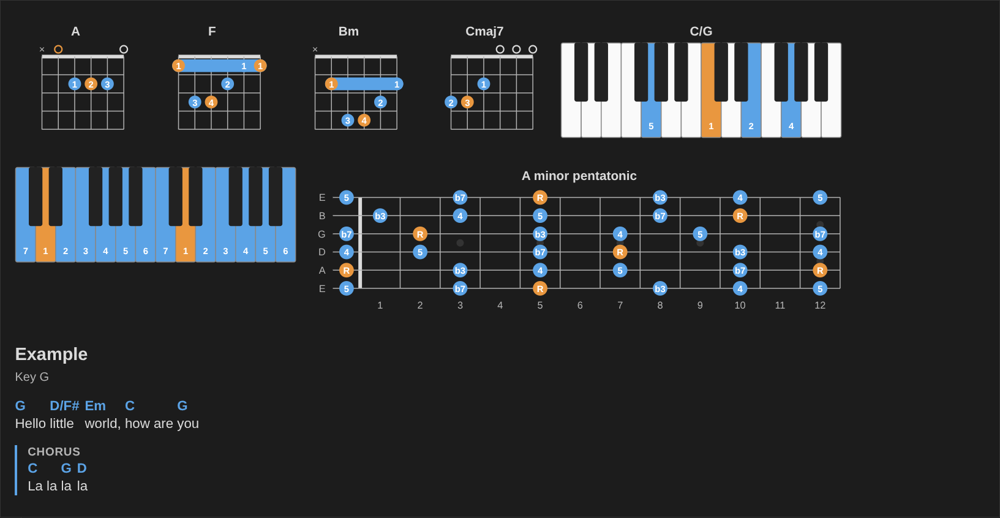

# Music Notation

Chord diagrams, piano keyboards, fretboards and ChordPro charts, drawn from small text blocks. It works in Obsidian (with the [Music Practice](https://github.com/dsebastien/obsidian-music-practice) plugin), on Obsidian Publish, and on any web page.

- [Blocks](blocks.md): the syntax of each block.
- [Obsidian Publish](publish.md): show the blocks on your Publish site.
- [JavaScript API](api.md): render blocks from your own code.

A block with a mistake shows a short message saying what's wrong, and its source stays visible.
