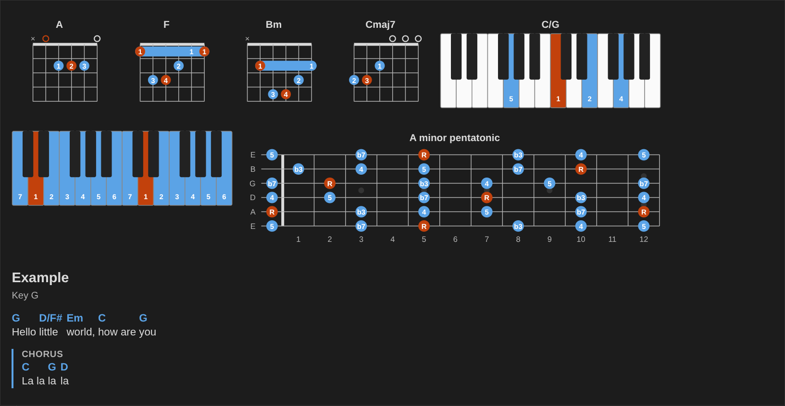

# Music Notation

Chord diagrams, piano keyboards, fretboards, ChordPro charts, [strumming patterns](blocks.md#strumming-patterns), [progressions](blocks.md#progressions) and the [circle of fifths](blocks.md#circle-of-fifths), drawn from small text blocks. It works in Obsidian (with the [Music Practice](https://github.com/dsebastien/obsidian-music-practice) plugin), on Obsidian Publish, and on any web page.

And there's more:

- A [capo](blocks.md#capo) on any guitar chord or fretboard, with the chord it sounds.
- [Arpeggios](blocks.md#arpeggios), one CAGED shape at a time or all of them up the neck.
- [Piano voicings](blocks.md#piano-voicings): inversions, shell and rootless voicings, and both hands.
- [Chord diagrams in a chart](blocks.md#chord-diagrams-in-a-chart), with your own shapes (`{define}`) and the capo.
- A key finder: give a [progression](blocks.md#progressions) its chord names and it finds the key, or ask [which scale fits](blocks.md#which-scale-fits) a song's chords.
- [Follow the notes](blocks.md#hear-the-diagrams): with playback on, each note lights up on the drawing when you hear it.

- [Blocks](blocks.md): the syntax of each block, with live results.
- [Examples](examples.md): a gallery of chords, keyboards, fretboards, charts, strumming patterns, progressions and more, drawn live.
- [Playground](playground.md): examples for every block, a Surprise me button, play bars, note names, and a link to share what you wrote.
- [Obsidian Publish](publish.md): show the blocks on your Publish site.
- [JavaScript API](api.md): render blocks from your own code.
- [Check your notes](check.md): find the blocks with mistakes in your Markdown files, from the command line.

A block with a mistake shows a short message saying what's wrong, and its source stays visible.
